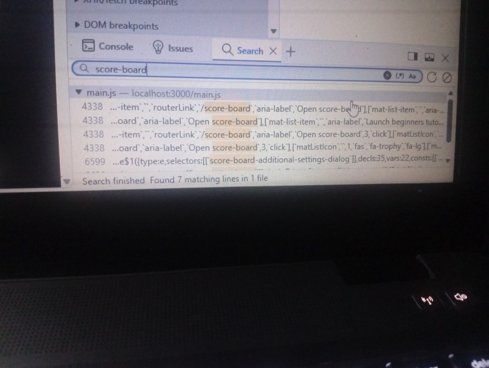
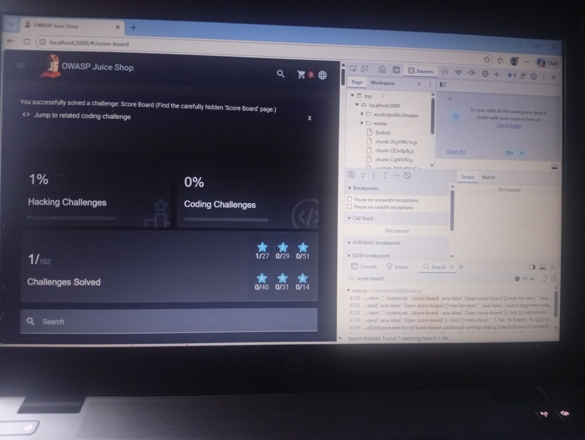

# OWASP Juice Shop Write-ups

My notes from working through [OWASP Juice Shop](https://owasp.org/www-project-juice-shop/), a deliberately vulnerable web app built for security training. Everything here was done on my own local copy (Docker, `localhost:3000`). No real systems were touched.

| # | Challenge | Difficulty | Category | Write-up |
|---|-----------|------------|----------|----------|
| 1 | Score Board | ⭐ | Miscellaneous | [Read](#challenge-1-score-board-) |

**Setup:** Windows laptop, Docker Desktop + WSL 2, `docker run -d -p 3000:3000 bkimminich/juice-shop`, Microsoft Edge DevTools.

*Ugwu Kingsley · [github.com/buccitech](https://github.com/buccitech) · X [@Lucaswilliamsq](https://x.com/Lucaswilliamsq)*

---

## Challenge 1: Score Board ⭐

**Goal:** Find the carefully hidden "Score Board" page.
**Date solved:** 16 November 2026
**Tools:** Microsoft Edge DevTools (Sources tab, search across files)

## What I did

1. Opened Juice Shop at `http://localhost:3000`. There is no link to a Score Board anywhere in the menu.
2. Opened DevTools (F12) and went to the **Sources** tab to look at the JavaScript the browser downloaded.
3. Pressed **Ctrl+Shift+F** to search all files.
   - Searching `score` returned 71 matches, mostly text labels. Too noisy.
   - Searching `path:` returned Angular framework code, not the app's pages.
   - Searching `score-board` narrowed it down to 7 lines in `main.js`.
4. One match showed `routerLink: '/score-board'`, which is the route the app uses for the page.
5. Visited `http://localhost:3000/#/score-board`. The page loaded and Juice Shop confirmed the challenge was solved.

## What I learned

- **Hiding a link is not security.** The page was missing from the menu, but its route was sitting in the JavaScript that every visitor downloads.
- Single-page apps (Angular, React, Vue) ship their whole route list to the browser, so reading the front-end code is a quick way to map an app's pages during recon.
- Narrowing a search step by step (`score` → `path:` → `score-board`) saved time compared with reading the minified code line by line.

## How a developer should fix it

- Don't rely on obscurity. If a page should be private, protect it with authentication and authorisation checks on the server.
- Keep sensitive or admin features behind access control, not just out of the navigation.

## References

- [OWASP Juice Shop companion guide](https://pwning.owasp-juice.shop/)
- [OWASP Top 10: A01 Broken Access Control](https://owasp.org/Top10/A01_2021-Broken_Access_Control/)
